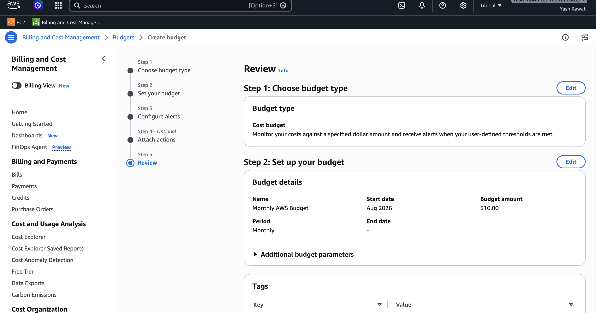
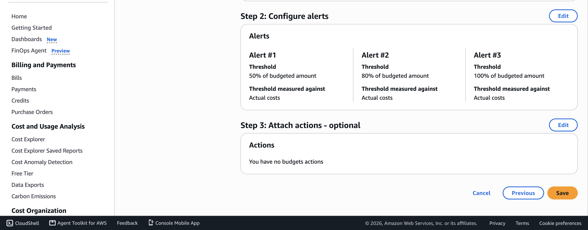

# Assignment 1 — Creating an AWS Free Tier Account & Setting Up Budget Management and Alerts

Part of the DevOps Micro Internship (DMI) with Agentic AI

---

## Purpose

In this assignment, you will create your own AWS Free Tier account and configure budget management with cost alerts. This is an important first step: it lets you follow along with the rest of the course, and the alerts help ensure you do not exceed your budget.

---

# Task 1 — Sign Up for AWS

## Goal

Create your AWS Free Tier account and select the Basic Support Plan (Free).

> No screenshot required for this task.

---

# Task 2 — Log in to the AWS Management Console

## Goal

Log in to your AWS account and access the AWS Management Console.

> No screenshot required for this task.

---

# Task 3 — Familiarize Yourself with the AWS Console

## Goal

Explore the AWS Management Console and review the AWS Free Tier offerings.

> No screenshot required for this task.

---

# Task 4 — Access the Billing Dashboard

## Goal

Open the Billing Dashboard from the AWS Management Console.

> No screenshot required for this task.

---

# Task 5 — Create a Budget

## Goal

Configure a monthly Cost Budget with a descriptive name, the current month as the start month, and your selected budget amount.

> No screenshot required for this task.

---

# Task 6 — Set Budget Alerts

## Goal

Configure budget alert thresholds, such as 50%, 80%, and 100%, and enter your notification email address.

> No screenshot required for this task.

---

# Task 7 — Review & Confirm Your Budget

## Goal

Review your budget and notification settings, then create the budget.

### Evidence

#### Screenshot 1 — AWS Budget setup page showing the budget name, budget amount, and alert thresholds

### Notes

Answer the following in your own words:

**1. Why is it important to set up budget alerts when using an AWS account?**

**Answer:** Budget alerts help monitor AWS spending and notify you when costs reach set thresholds, helping prevent unexpected charges and maintain cost control.

---

# Task 8 — Share Your Progress on WhatsApp

## Goal

Publish the automatically generated DMI Leaderboard message containing your rank and personal progress link on your WhatsApp Status.

Go to the DMI Leaderboard, find your name, select **Share your progress**, and click the **WhatsApp icon**. Copy the generated message, paste it into your WhatsApp Status, and publish it.

### Evidence

#### Screenshot 2 — Published WhatsApp Status showing the automatically generated DMI Leaderboard rank and personal progress link

Add your screenshot here.

> **Privacy Note:** Make sure no private phone numbers, personal messages, or sensitive information are visible in the screenshot.

---

# Submission Instructions

- Add Screenshot 1 showing your AWS budget name, amount, and alert thresholds
- Answer the Notes question under Task 7 in your own words
- Add Screenshot 2 showing your published WhatsApp Status with your DMI Leaderboard rank and personal progress link
- Do not expose sensitive billing, card, identity, account information, private phone numbers, or personal messages

---

# Completion Checklist

- [x] AWS Free Tier account created and Basic Support Plan (Free) selected
- [x] Logged in to the AWS Management Console
- [x] Monthly Cost Budget created with name, amount, and start month
- [x] Budget alert thresholds and notification email configured
- [x] Screenshot captured showing budget name, amount, and thresholds (Screenshot 1)
- [x] Notes question answered
- [x] No sensitive billing or account information exposed

---

## 📌 About DMI & CloudAdvisory

DevOps Micro Internship (DMI) is a project-based DevOps program run by Pravin Mishra (The CloudAdvisory) focused on real-world execution, systems thinking, and career readiness.

It helps learners build strong DevOps foundations with hands-on experience.

---

## 📌 Resources

- 🌐 DMI Official Website: https://dmi.pravinmishra.com?utm_source=github&utm_medium=readme  
- 🎓 University: https://university.pravinmishra.com?utm_source=github&utm_medium=readme  
- 💬 Discord Community: https://discord.pravinmishra.com?utm_source=github&utm_medium=readme  
- 📝 Blog: https://dmi.pravinmishra.com/blog?utm_source=github&utm_medium=readme  
- ▶️ YouTube Playlist: https://www.youtube.com/playlist?list=PLFeSNDtI4Cho  
- 🔗 Pravin Mishra (LinkedIn): https://www.linkedin.com/in/pravin-mishra-aws-trainer/  
- 🏢 CloudAdvisory (LinkedIn): https://www.linkedin.com/company/thecloudadvisory/

---

*This submission is part of DevOps Micro Internship (DMI) — Agentic AI Track.*
